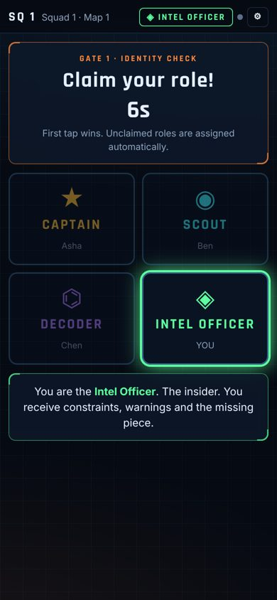
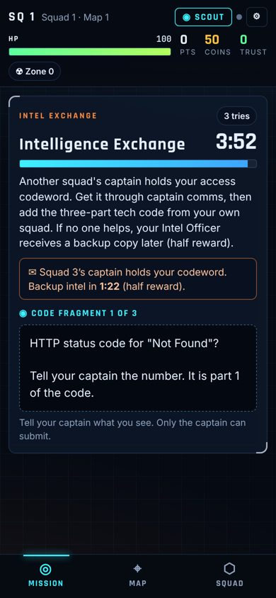
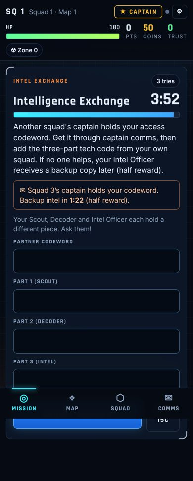
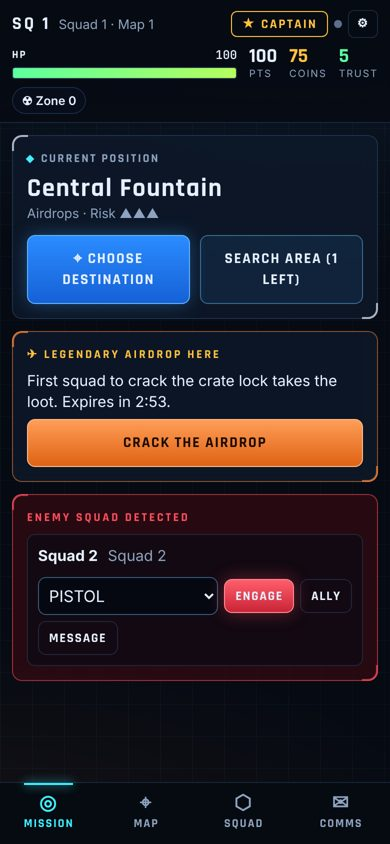
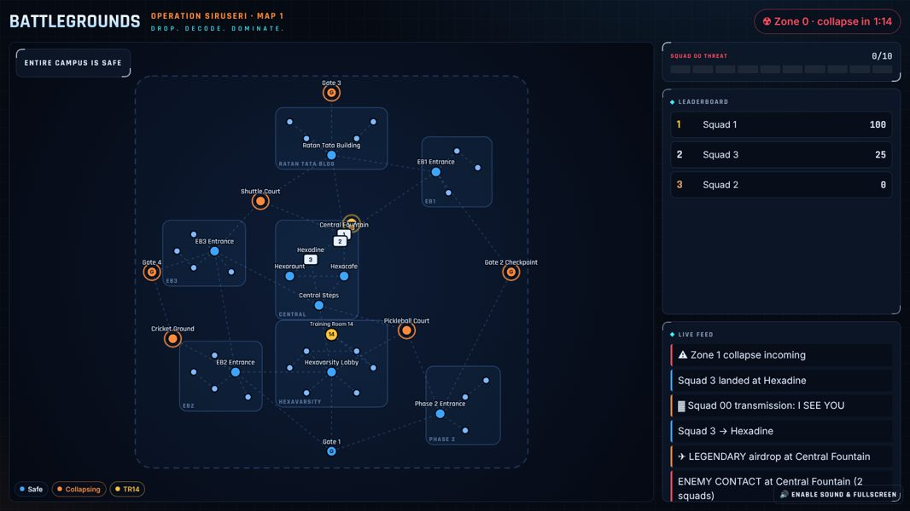
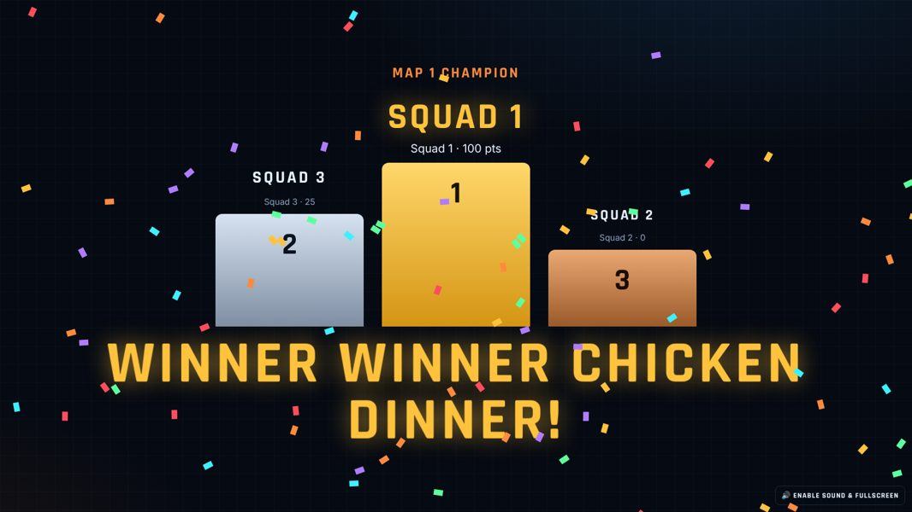

# Hexaware Battlegrounds × Operation Siruseri

**Drop. Decode. Dominate.** A host-controlled, real-time, mobile-first multiplayer survival game for an in-room corporate event. Squads of four (Captain, Scout, Decoder, Intel Officer) drop onto a stylised Hexaware Siruseri campus, split clues across four phones, fight puzzle duels, chase airdrops, negotiate with other captains and converge on **Hexavarsity Training Room 14** for a simultaneous finale.

- **60 players per map** (15 squads). Bigger events run **parallel maps** (Map 2, Map 3…) on the same campus, controlled from one host console, with a fair combined grand champion.
- **Zero cost hosting:** Vercel Hobby (frontend) + Supabase Free (Postgres, Realtime), added from inside Vercel.
- **Server-authoritative:** every rule, timer, score and answer check runs inside Postgres. Browsers never receive answers and cannot touch tables.

| Screen | URL | Who |
|---|---|---|
| Player app | `/join` → `/play` | Every participant, on their own phone |
| Host console | `/host` | Organiser (password-protected) |
| Projector | `/screen/<token>` | One per map, read-only, revocable |

<p>




</p>
<p>


</p>

More in [`docs/screenshots/`](docs/screenshots) (host console, mission editor, finale, Squad 00 reveal).

---

## Deploy for free (about 15 minutes)

### 1. Put the code on GitHub
Create a repository and push this folder.

### 2. Create the Vercel project
1. Vercel → **Add New → Project** → import the repository. Framework is detected as **Vite** (`vercel.json` is included). Don't deploy yet, or let the first deploy fail — it needs the database variables.

### 3. Add the database from inside Vercel
1. In the Vercel project → **Storage** → **Create Database** → choose **Supabase** (Marketplace) → Free plan → connect it to this project.
2. Vercel injects `NEXT_PUBLIC_SUPABASE_URL` and `NEXT_PUBLIC_SUPABASE_ANON_KEY` into the project. The app reads these directly (`vite.config.ts` allows the `NEXT_PUBLIC_` prefix) — nothing to rename.
   - Prefer to create Supabase yourself? Set `VITE_SUPABASE_URL` and `VITE_SUPABASE_ANON_KEY` in Vercel → Settings → Environment Variables instead.

### 4. Create the game database
1. Open the Supabase dashboard (Vercel → Storage → your database → **Open in Supabase**).
2. **SQL Editor → New query** → paste the whole of [`supabase/setup.sql`](supabase/setup.sql) → **Run**. It creates every table, the game engine, the map and the 145-mission library. Re-running it later is safe (it updates in place).
   - With the Supabase CLI instead: `supabase link` then `supabase db push` (uses `supabase/migrations/`).
3. **Realtime:** Project Settings → Realtime → make sure **public channels are allowed** (do not enable "private channels only"). The game only sends tiny "something changed" pings on public channels — never game data — and falls back to polling if Realtime is unavailable.

### 5. Deploy
Vercel → **Deployments → Redeploy**. Open `https://<your-app>.vercel.app/host` → **Create event** (event code, host password, number of maps).

### 6. Before the event
Follow [`docs/HOST_MANUAL.md`](docs/HOST_MANUAL.md) — especially the rehearsal checklist.

> **Free-tier notes (check current limits on vercel.com/pricing and supabase.com/pricing):** a free Supabase project pauses after about a week without activity — open the dashboard or run a rehearsal the day before. Supabase Free allows roughly 200 concurrent Realtime connections: one map (~62 connections incl. host + projector) or two maps (~124) is comfortable, three (~186) is the ceiling. Vercel Hobby is intended for non-commercial use; confirm an internal event is acceptable for your organisation.

---

## Run it locally (no accounts needed)

```bash
npm install
npm run local        # terminal 1: embedded Postgres game server on :54321 (real migrations)
npm run dev:local    # terminal 2: app on http://localhost:5173
```
Open `/host` → Create event → Links & PINs → generate squads → join from phones/tabs. Realtime isn't emulated locally, so screens poll every 2–3 s. `PERSIST=1 npm run local` keeps data between restarts. To test on phones over Wi-Fi, run `npx vite --host` with the same env vars and use your laptop's IP.

Against a real Supabase project: copy `.env.example` → `.env.local`, fill in the values, `npm run dev`.

## Commands

| Command | What it does |
|---|---|
| `npm test` | 21 engine tests on the real SQL in embedded Postgres (joining, PIN lockout, race-safe roles, captain-only rules, answer secrecy, idempotent scoring, battles, recovery, airdrop races, relay fallback, chat limits, alliances, pause/resume, zone, finale, reveal gating, permissions) |
| `npm run build` | Type-check and build for production |
| `npm run content` | Regenerate the map/mission seed (`0005_content.sql`) from `content/*.mjs` |
| `npm run db:bundle` | Rebuild `supabase/setup.sql` from the migrations |
| `npm run loadtest` | Simulate squads × 4 phones (`SUPABASE_URL`, `SUPABASE_KEY`, `SQUADS`, `MINUTES`) |
| `npm run local` | Offline game server for rehearsals |

## Project layout

```
supabase/migrations/   0001 schema · 0002 core engine & tick · 0003 player/captain API · 0004 host & projector API · 0005 content (generated)
supabase/setup.sql     everything above in one paste-able file
content/               editable campus map, items and the mission generator
src/pages/             Join, Play (four role views), Host console, Screen (projector)
src/components/        CampusMap (pan/zoom/zone/airdrops), shared HUD components
src/lib/               RPC client, live sync (realtime + polling + deadline refresh), server clock, synthesised SFX
scripts/               local server, load test, content & SQL bundlers
tests/                 engine tests
docs/                  architecture, game design, host manual
```

## Documentation
- [Architecture, data model, API & realtime contract](docs/ARCHITECTURE.md)
- [Game design, economy & 120-minute run-sheet](docs/GAME_DESIGN.md)
- [Host manual, rehearsal checklist, recovery procedures, known limitations](docs/HOST_MANUAL.md)

All sounds are synthesised in the browser and all content is original — no PUBG assets, branding, maps or audio.
