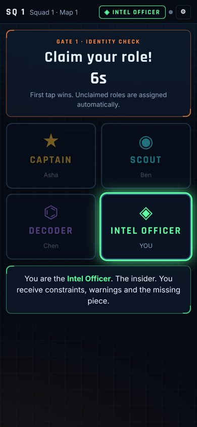
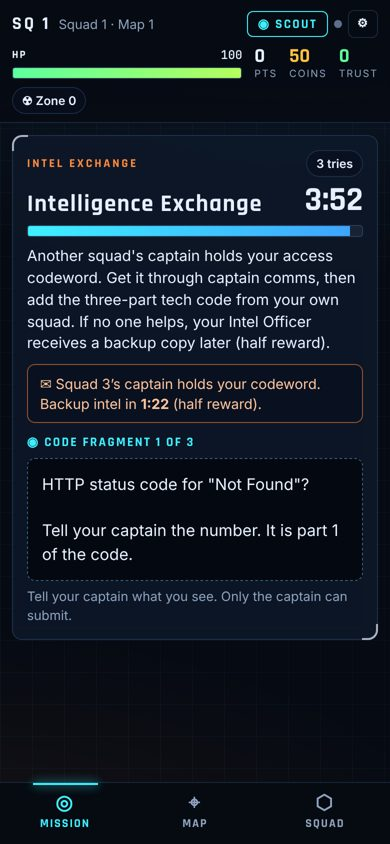
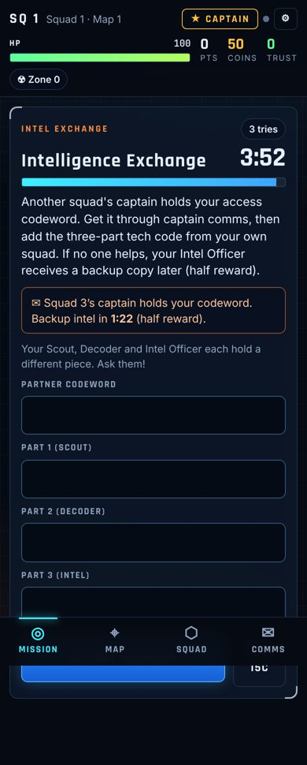
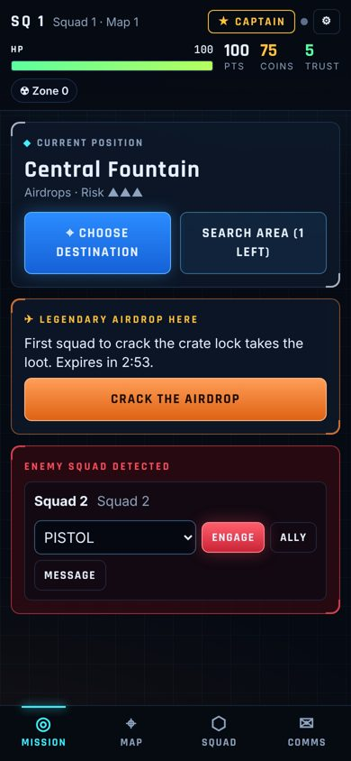
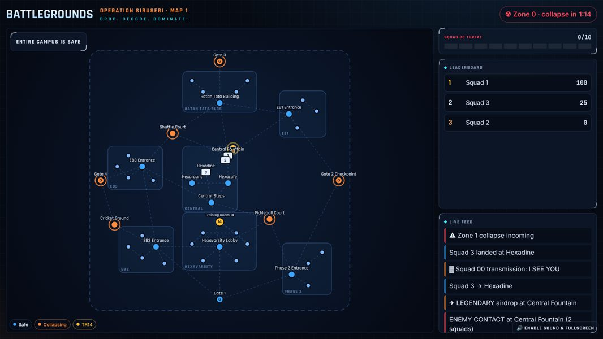
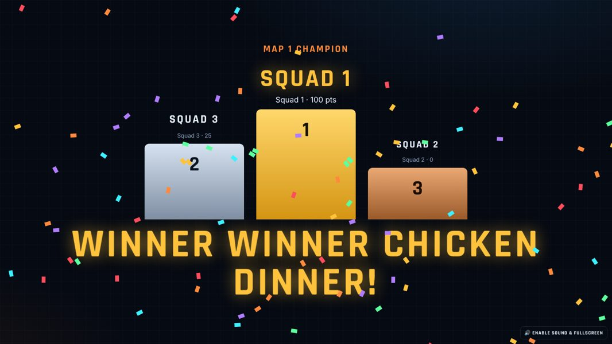

# Hexaware Battlegrounds × Operation Siruseri

**Drop. Decode. Dominate.** A host-controlled, real-time, mobile-first multiplayer survival game for an in-room corporate event. Squads of four (Captain, Scout, Decoder, Intel Officer) ride a 3D shuttle to Gate 1, parachute onto a **3D Hexaware Siruseri campus**, run it with a Free Fire-style joystick, split clues across four phones, fight puzzle duels, chase airdrops, dodge red zones and a shrinking safe circle, negotiate with other captains and converge on **Hexavarsity Training Room 14** for a simultaneous finale.

- **Up to 60 players per map** (15 squads; a map can start with any number of complete squads from 1 to 15). Bigger events run **parallel maps** (Map 2, Map 3…) on the same campus, controlled from one host console, with a fair combined grand champion.
- **Zero cost hosting:** Vercel Hobby (frontend) + Supabase Free (Postgres, Realtime), added from inside Vercel.
- **Server-authoritative:** every rule, timer, score and answer check runs inside Postgres. Browsers never receive answers and cannot touch tables.

| Screen | URL | Who |
|---|---|---|
| Player app | `/join` → `/play` | Every participant, on their own phone |
| Host console | `/host` | Organiser (password-protected) |
| Projector | `/screen/<token>` | One per map, read-only, revocable |

<p>




</p>
<p>


</p>

More in [`docs/screenshots/`](docs/screenshots) (host console, mission editor, finale, Squad 00 reveal).

---

## Deploy for free (about 15 minutes)

### 1. Put the code on GitHub
Create a repository and push this folder.

### 2. Create the Vercel project
1. Vercel → **Add New → Project** → import the repository. Framework is detected as **Vite** (`vercel.json` is included). Don't deploy yet, or let the first deploy fail — it needs the database variables.

### 3. Add the database from inside Vercel
1. In the Vercel project → **Storage** → **Create Database** → choose **Supabase** (Marketplace) → Free plan → connect it to this project.
2. Vercel injects `NEXT_PUBLIC_SUPABASE_URL` and `NEXT_PUBLIC_SUPABASE_ANON_KEY` into the project. The app reads these directly (`vite.config.ts` allows the `NEXT_PUBLIC_` prefix) — nothing to rename.
   - Prefer to create Supabase yourself? Set `VITE_SUPABASE_URL` and `VITE_SUPABASE_ANON_KEY` in Vercel → Settings → Environment Variables instead.

### 4. Create the game database
1. Open the Supabase dashboard (Vercel → Storage → your database → **Open in Supabase**).
2. **SQL Editor → New query** → paste [`supabase/setup/part-01.sql`](supabase/setup) → **Run**, then repeat for `part-02.sql` … `part-28.sql` **in order** (a new query each time is fine). Each part is a single line under 18,000 characters, because the editor accepts at most 100,000 characters per query and some copy paths cut text at 20,000. Together they create every table, the game engine, the map and the 191-challenge library. Re-running them is safe.
   - **Already ran `supabase/upgrade-2` (open world)?** Run only [`supabase/upgrade-3/upgrade3-01.sql`](supabase/upgrade-3) … `upgrade3-22.sql`, in order. They add free hints, answer reveals with a points penalty, the easier challenge pack and the **automatic match** (one *Start match* runs the whole game).
   - **Already ran `supabase/upgrade` (match phases)?** Run only [`supabase/upgrade-2/upgrade2-01.sql`](supabase/upgrade-2) … `upgrade2-22.sql`, in order. They add the open world (positions, joystick movement, circular zone, red zones), challenge pack 2 and remove trial mode, without touching squads or scores. Each part is under ~10,000 characters.
   - **Only ran the original setup (part-01 … part-19)?** Run everything in [`supabase/upgrade/`](supabase/upgrade) (`upgrade-01` … `upgrade-28`) in order — it contains both upgrades.
   - Easiest of all for any upgrade: `DATABASE_URL="<POSTGRES_URL_NON_POOLING>" npm run db:setup` runs every migration (safe to re-run).
   - **No SQL Editor? Use one command from your laptop:** copy `POSTGRES_URL_NON_POOLING` from Vercel → Settings → Environment Variables, then in this folder run `npm install` and `DATABASE_URL="<that value>" npm run db:setup` (Windows PowerShell: `$env:DATABASE_URL="<value>"; npm run db:setup`).
   - Vercel's own query box runs one statement at a time and will fail with "cannot insert multiple commands into a prepared statement" — use Supabase's SQL Editor or `npm run db:setup` instead.
   - With the Supabase CLI instead: `supabase link` then `supabase db push` (uses `supabase/migrations/`).
3. **Realtime:** Project Settings → Realtime → make sure **public channels are allowed** (do not enable "private channels only"). The game only sends tiny "something changed" pings on public channels — never game data — and falls back to polling if Realtime is unavailable.

### 5. Deploy
Vercel → **Deployments → Redeploy**. Open `https://<your-app>.vercel.app/host` → **Create event** (event code, host password, number of maps).

### 6. Before the event
Follow [`docs/HOST_MANUAL.md`](docs/HOST_MANUAL.md) — especially the rehearsal checklist.

> **Free-tier notes (check current limits on vercel.com/pricing and supabase.com/pricing):** a free Supabase project pauses after about a week without activity — open the dashboard or run a rehearsal the day before. Supabase Free allows roughly 200 concurrent Realtime connections: one map (~62 connections incl. host + projector) or two maps (~124) is comfortable, three (~186) is the ceiling. Vercel Hobby is intended for non-commercial use; confirm an internal event is acceptable for your organisation.

---

## Run it locally (no accounts needed)

```bash
npm install
npm run local        # terminal 1: embedded Postgres game server on :54321 (real migrations)
npm run dev:local    # terminal 2: app on http://localhost:5173
```
Open `/host` → Create event → Links & PINs → generate squads → join from phones/tabs. Realtime isn't emulated locally, so screens poll every 2–3 s. `PERSIST=1 npm run local` keeps data between restarts. To test on phones over Wi-Fi, run `npx vite --host` with the same env vars and use your laptop's IP.

Against a real Supabase project: copy `.env.example` → `.env.local`, fill in the values, `npm run dev`.

## Commands

| Command | What it does |
|---|---|
| `npm test` | 38 tests on the real SQL in embedded Postgres: 21 engine tests (joining, PIN lockout, race-safe roles, captain-only rules, answer secrecy, idempotent scoring, battles, recovery, airdrops, relays, chat, alliances, pause/resume, circular zone damage, finale, permissions), 10 P0 tests (phases and duel lock, phase-driven zone, auto pacing, timer scaling, PINs and reset, CSV validation, cross-map isolation, identical finale across maps) and 6 open-world tests (start with fewer squads, server speed cap, location areas, distance-based travel time, duel range, red zones) |
| `npm run build` | Type-check and build for production |
| `npm run content` | Regenerate the map/mission seed (`0005`–`0024` and `0210`+ content migrations) from `content/*.mjs` |
| `npm run db:bundle` | Rebuild `supabase/setup/`, `supabase/upgrade/` and `supabase/upgrade-2/` from the migrations |
| `npm run loadtest` | Simulate squads × 4 phones (`SUPABASE_URL`, `SUPABASE_KEY`, `SQUADS`, `MINUTES`) |
| `npm run local` | Offline game server for rehearsals |

## Project layout

```
supabase/migrations/   0001 schema · 0002 core engine & tick · 0003 player/captain API · 0004 host & projector API · 0005–0024 content · 0100 match phases & squad prep · 0200 open world, circular zone, red zones · 0210+ challenge pack 2
supabase/setup/        all migrations packed into paste-able parts (fresh install, run in order)
supabase/upgrade/      incremental migrations 0100+ (databases that ran only the original setup)
supabase/upgrade-2/    incremental migrations 0200+ (databases that already ran supabase/upgrade)
supabase/upgrade-3/    incremental migrations 0300+ incl. autopilot 0400 (databases that already ran supabase/upgrade-2)
content/               editable campus map, items and the challenge generators (missions.mjs, missions2.mjs)
src/pages/             Join, Play (world HUD + four role views), Host console, Screen (projector)
src/three/             3D campus world and 3D shuttle bus (three.js, lazy-loaded)
src/components/        CampusMap (2D tactical map), Fruit Slash, shuttle, shared HUD components
src/lib/               RPC client, live sync (realtime + polling + deadline refresh), server clock, synthesised SFX
scripts/               local server, load test, content & SQL bundlers
tests/                 engine tests
docs/                  architecture, game design, host manual
```

## Documentation
- [Architecture, data model, API & realtime contract](docs/ARCHITECTURE.md)
- [Game design, economy & 120-minute run-sheet](docs/GAME_DESIGN.md)
- [Host manual, rehearsal checklist, recovery procedures, known limitations](docs/HOST_MANUAL.md)
- [Design audit (Apple design / mobile-native review)](docs/DESIGN_AUDIT.md)
- [Feature audit and P0 status](docs/AUDIT.md)

All sounds are synthesised in the browser and all content is original — no PUBG assets, branding, maps or audio.
