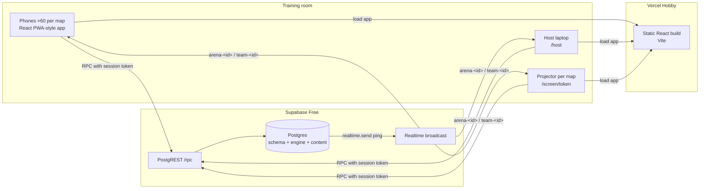
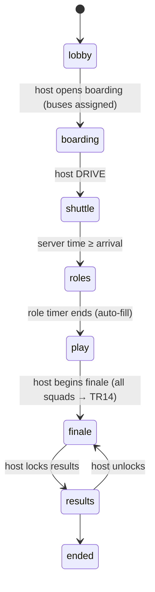

# Architecture

## 1. Constraints that shaped the design

| Requirement | Constraint | Decision |
|---|---|---|
| Real-time multiplayer, server-authoritative | Must be free; hosted on Vercel | Vercel serves the static React app only. All game logic runs **inside Postgres** (Supabase Free) as `SECURITY DEFINER` functions. |
| WebSockets | Vercel functions cannot hold long-lived sockets | **Supabase Realtime** broadcast carries tiny "changed" pings. Clients re-fetch their own filtered snapshot by RPC. Polling is the fallback. |
| Timers resolve without a client | No always-on server on the free plan | Every deadline is a server timestamp. A rate-limited **tick** runs on every read (players, host, projector), resolving everything that is due, under an advisory lock. |
| 200 players | Free Realtime ≈ 200 concurrent connections | **Max 60 players per map**, parallel maps for more. Each phone uses one socket. |
| Redis (spec) | Extra paid service | Dropped. Postgres row locks, unique indexes and advisory locks give the same guarantees at this scale. |

The spec suggested FastAPI + WebSockets + Redis on Render. That needs an always-on server (Render's free tier sleeps and cold-starts mid-event). Moving the engine into Postgres removes the server entirely, keeps a single source of truth and makes every rule transactional.

## 2. System view

Request path: phone → `supabase.rpc('captain_submit', {p_token,…})` → function checks the token hash, role, phase and pause → validates the answer server-side → writes ledger + state in one transaction → pings the squad/arena topic → every affected phone re-fetches its own `player_state`.

## 3. Parallel maps ("arenas")

- An **event** has 1–6 **arenas** (Map 1, Map 2…). Squads are assigned at creation (15 per map by default, `arena_size`).
- Each arena has its own phase, shuttle, zone timeline, encounters, airdrops, chat, Squad 00 threat, finale rounds, results and projector token.
- One host console controls each map or **all maps at once** (commands sent with `p_arena = null` are applied to every arena, each audited).
- **Fairness across maps:** mission variation uses the event-wide `mission_seed`; finale rounds pick the same template on every map (seed + round index). The grand champion uses the same deterministic ordering over all maps.

## 4. Security model

| Concern | Implementation |
|---|---|
| Direct table access | RLS enabled on every table with **no policies**; all table privileges revoked from `anon`/`authenticated`. |
| What the browser can call | Only the API functions are granted `EXECUTE`; every internal `_function` is revoked (verified by tests). |
| Player identity | `join_team` returns a random 256-bit session token; only its SHA-256 is stored. Rejoining with the same token never consumes a slot. |
| Team PINs | Salted SHA-256, never returned. 8 wrong PINs per squad in 5 min → lockout. PINs never appear in QR codes or URLs. Squads are organiser-created; a PIN only admits to that squad until the roster locks at 4/4. |
| Captain-only actions | Every `captain_*` function re-checks `role = 'captain'`, phase and pause. |
| Clue secrecy | `player_state` returns the clue for **your role only**; the captain gets answer-box labels, never clues. Answers never leave the database (tests scan responses for leaks). |
| Answer validation | Normalised (A–Z0–9) comparison inside the DB; multi-part answers; relay codewords checked against the instance. |
| Duplicate / replayed submissions | Idempotency key per submission (unique). Ledger `(team, kind, ref)` unique → a reward can never be applied twice. |
| Races | Role claim: unique partial index. Airdrop: conditional `update … where claimed_by is null`. Battles: row lock on the battle and both squads in id order. Tick: `pg_try_advisory_xact_lock` per arena. |
| Host | Password (salted hash), 24 h session tokens, login lockout, every command audited **including refused ones**, score edits require a reason. |
| Projector | Per-arena random token, read-only function, revocable; returns public data only (scores hidden during the finale). |

## 5. Timers and the tick

`_tick(arena)` runs at most every 800 ms per arena, triggered by any `player_state`, `spectator_state`, `host_overview` or captain action. It resolves, in order: shuttle arrival → role deadline (auto-fill roles) → travel arrivals (auto-start a location mission, encounter detection, relocation bonus) → battle timeouts (draw) → expired missions (penalty) → recovery timeouts (bounded respawn) → finale round deadlines → zone schedule and collapse (damage once per stage + evacuation to the nearest safe node by BFS) → automatic airdrops → expiry of airdrops and alliances.

Clients also schedule a refresh just after the next known deadline, so outcomes appear on time even without a ping. **Pause** freezes the tick; **resume** shifts every deadline in the arena by the pause length. A backend restart loses nothing: state lives only in Postgres.

## 6. State machines

Squad state: `idle ⇄ traveling`, `idle → recovery → idle` (0 HP never eliminates). Activities: one active main activity (mission / relay / airdrop / recovery / finale round) plus at most one battle, enforced by partial unique indexes.

## 7. Data model

Implemented tables (spec entity → table):

| Spec entities | Table(s) | Notes |
|---|---|---|
| events, event_settings | `events` | settings as JSON over engine defaults (`_defaults()`) |
| — | `arenas` | parallel maps; phase, zone, finale, overlay, results |
| teams, shuttle_assignments, squad_positions | `teams` | bus, location, travel, HP/coins/points/trust, cooldowns |
| registrations, players, player_sessions, role_assignments | `players` | display name, consent, hashed session, role (unique per squad) |
| map_locations, map_edges | `locations`, `edges` | editable via `content/map.mjs`; host can enable/disable |
| item_catalog, inventories | `items`, `inventory` | |
| mission_templates, role_clues | `mission_templates` | clues per role as JSON; versioned; draft→review→approved→published→retired |
| mission_instances | `mission_instances` | stores template version, partner/relay key, sync round |
| mission_submissions, challenge_attempts | `submissions` | idempotency key |
| score/hp/trust/loot transactions | `ledger` | one ledger, separate columns; unique `(team, kind, ref)` |
| battles, participants, results | `battles` | two participants by design (queue = one battle per squad) |
| airdrops | `airdrops` | |
| chat_requests, chat_messages | `chat_messages`, `chat_blocks` | captain-only, rate-limited, report/hide |
| alliance_requests, alliances | `alliances` | proposed → active → ended/expired/betrayed |
| intel_dependencies | `mission_instances.partner_team_id/relay_key/fallback_at` | |
| global_story_events | `story_events` | transmissions, bargains, reveal |
| game_events (public log) | `game_feed` | sequenced id = sequence number |
| host_commands, audit_logs | `audit_log` | |
| zone_stages, zone_events | `locations.collapse_stage` + `arenas.zone_*` + feed | |
| spectator_sessions | `arenas.spectator_token` | |
| event_snapshots | not needed | every read is a full snapshot computed from durable state |

## 8. API (Postgres functions via `/rest/v1/rpc`)

| Audience | Functions |
|---|---|
| Public | `map_data()` |
| Player | `join_team`, `claim_role`, `player_state` |
| Captain only | `captain_move`, `captain_explore`, `captain_submit`, `captain_hint`, `captain_use_item`, `captain_buy`, `captain_attack`, `captain_claim_airdrop`, `captain_chat`, `captain_block`, `captain_report`, `captain_alliance`, `captain_bargain` |
| Host | `host_create_event`, `host_login`, `host_generate_teams`, `host_import_teams`, `host_overview`, `host_command` (≈45 commands), `host_settings`, `host_missions`, `host_save_mission`, `host_test_answer`, `host_chat_log`, `host_audit`, `host_export` |
| Projector | `spectator_state` |

Errors are short codes (`NOT_CAPTAIN`, `ROLE_TAKEN`, `DANGER_ZONE`…) mapped to friendly text in `src/lib/api.ts`. Function signatures are the contract; Supabase also exposes them in its auto-generated OpenAPI document at `/rest/v1/`.

## 9. Realtime contract

- Topics: `arena-<arena_id>` (everyone on the map, host, projector) and `team-<team_id>` (the squad's four phones). Event name is always `ping`, payload `{k: <kind>}`.
- Pings carry **no game data**, so public channels leak nothing. Kinds: `phase, tick, host, roster, move, score, encounter, battle, airdrop, zone, mission, result, attempt, hint, item, chat, alliance, bargain, intel, recovery, threat, grand, revoked`.
- Frequent low-priority arena kinds (`score, move, roster, threat, intel`) are coalesced to one per 1.5 s.
- Client behaviour: ping → jittered re-fetch (80–400 ms, spreads 60 phones), poll every 8 s while connected (3.5 s when not), re-fetch after known deadlines and on tab focus/network return. Because every fetch is a complete snapshot, reconnecting can never duplicate a reward.
- `game_feed` is the sequenced public event log (ids are sequence numbers) that the projector and phones render.

## 10. Capacity (per map: 60 phones + host + projector)

| Resource | Estimate for a 2 h game | Free allowance (approx.) |
|---|---|---|
| Realtime connections | 62 per map | ~200 concurrent |
| Realtime messages | arena pings ≤ 0.7/s × 62 + squad pings ≈ 2/s × 4 ≈ 160–200 k per map | ~2 M / month |
| RPC calls | ~8–12/s per map (polling + actions) | no hard request cap; DB compute is the limit |
| Database size | < 20 MB per event | 500 MB |

Local load test (15 squads, 60 phones): p50 7 ms, p95 ≈ 130 ms, 0 server errors; 45 of 60 simultaneous captain claims correctly rejected. Run `npm run loadtest` against your real project before the event — venue Wi-Fi is usually the bottleneck.

## 11. P0 additions (migration `0100_p0_phases_trial.sql`)
- **Incremental only.** Earlier migrations are unchanged. The migration adds columns (`events.is_trial`, `arenas.match_phase`, `phase_started_at`, `phase_next_at`, `zone_hold`), new settings keys, two triggers and new functions, and replaces a few function bodies with the same signatures (`_tick`, `_pick_template`, `_start_instance`, `host_command`, `host_generate_teams`, `host_import_teams`). It re-applies the browser whitelist, because Postgres grants EXECUTE on new functions to PUBLIC by default.
- **Public phase mirror.** The authoritative phase lives in `arenas.match_phase`; a copy (`phase`, `next_at`, `duel_phase`, `zone_target`) plus a `trial` flag is written to `arenas.overlay.match`, which `player_state` and `spectator_state` already return. So no existing API contract changed. `clear_overlay` keeps this key.
- **Duel lock.** A `before insert` trigger on `battles` raises `DUELS_LOCKED` below `duel_phase`; the whole captain action rolls back, so no weapon is consumed.
- **Tick.** Now also advances phases on the schedule and keeps contracting the zone toward the phase target, honouring `zone_hold`.
- **`_shift_arena(arena, interval)`** moves every timer of an arena. Resume uses it implicitly (phase timers) and trial fast-forward uses a negative interval.
- **Host command routing.** `host_command` keeps its signature and audit behaviour, routes new commands (`set_phase`, `next_phase`, `hide_rankings`, `reset_pin`, `trial_skip`, `trial_bots`, `trial_reset`) to `_host_exec_p0`, and wraps existing ones with phase hooks (resume, begin_finale, zone_cancel, reset). PINs never enter the audit log.
- **Trial isolation.** `trial_*` commands raise `TRIAL_ONLY` unless `events.is_trial`; trial events are created only through `host_create_trial` and are labelled on every screen.
- **New API functions:** `host_roster`, `host_create_trial`, `host_trial_status` (34 browser-callable functions in total).
- **Squad preparation.** PINs come from `_new_pin` (digits drawn from `gen_random_uuid`, i.e. the OS CSPRNG), default 6 digits. A `before insert` trigger on `teams` gives codenames (Alpha-01…) and a bus number. Import validates the whole file before writing and rejects weak PINs.
- **Simulated squads** are created by `trial_bots`, which calls the real `join_team` four times per squad. The host browser then drives them through the same RPCs as phones (`claim_role`, `captain_move`, `captain_explore`, `captain_submit`, `captain_attack`, `captain_claim_airdrop`).
